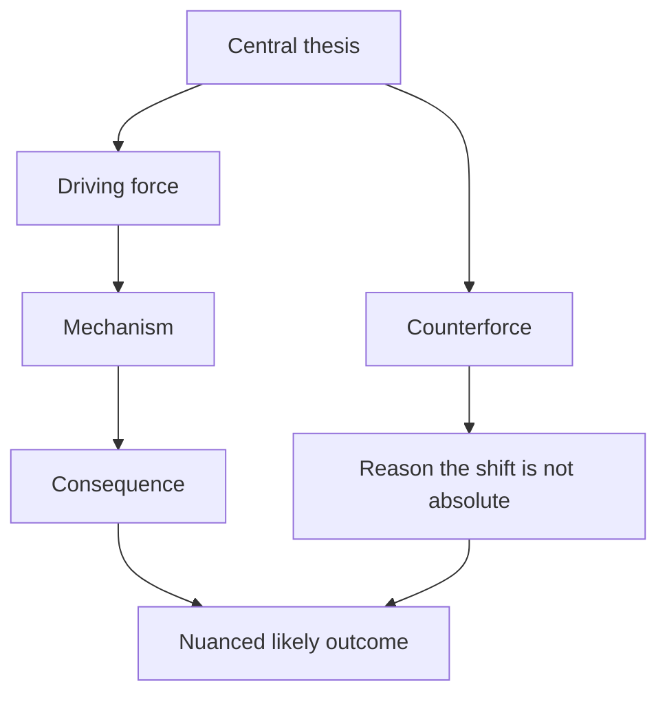

---
# GENERATED by scripts/sync.mjs from .agents/skills/idea-graph-generator/SKILL.md. Do not edit; edit the source and run `npm run sync`.
name: idea-graph-generator
description: Create a clear, Obsidian-friendly Mermaid flowchart from a thesis, notes, article links, or an existing map. Use whenever Arohbi asks to map an idea, argument, trend, or future scenario as a Mermaid chart or mind map, including when he supplies articles to incorporate.
---

# Idea Graph Generator

Create a Mermaid flowchart that maps a user's thesis and supporting ideas into a readable causal argument. The original examples focused on gaming futures, but apply the same method to other topics without forcing gaming-specific concepts into unrelated maps.

## Inputs

Accept any combination of:

- A thesis or rough notes typed by the user.
- Article links the user wants incorporated.
- The user's own take on each article, either stated alongside the link or elsewhere in the conversation.
- A previously generated or user-provided Mermaid graph to extend, correct, or reorganize.
- Corrections or additions to an existing map discussed earlier in the conversation.

Treat the user's stated thesis and opinions as the intended argument. Keep them recognizable while organizing them into causes, consequences, counterforces, and likely outcomes. Do not silently replace their position with a more conventional one.

## Workflow

1. **Choose the working baseline.** If the user provides a Mermaid graph or asks to continue a map from earlier in the conversation, use that graph as the baseline. Otherwise start from the supplied thesis and notes. If an earlier graph is unavailable in the current context, ask the user to provide it when continuity matters.
2. **Extract and extend the argument.** Identify the central thesis, causal sequence, supporting examples, countervailing forces, and final synthesis. For an existing graph, preserve its valid nodes, relationships, and structure where practical; integrate new ideas, evidence, or counterforces into the relevant branches. Make only the corrections, removals, or reorganizations the user requests or that are needed for clarity. Treat each turn as an incremental revision, not a reset.
3. **Read supplied articles when possible.** Open each URL and extract the claims or themes relevant to the map. Use search or another available browser tool if direct retrieval fails. Prefer the supplied article itself over summaries of it.
4. **Separate evidence from interpretation.** Preserve the user's opinions as their perspective. Phrase externally verifiable claims as factual only when supported. Mark forecasts and causal links as possibilities or inferences when they are not established facts. Do not invent the contents of inaccessible articles; if a link cannot be read and its point is unclear from the user-provided context, briefly say so and ask for the missing takeaway or proceed without attributing unverified details.
5. **Check time-sensitive claims.** Browse current sources for claims about recent announcements, prices, schedules, product capabilities, or industry conditions. Prefer primary sources for technical and corporate claims. Cite claims outside the Mermaid block with direct Markdown links; do not put citation syntax inside node labels unless the user asks for clickable nodes.
6. **Build the diagram.** Use `flowchart TD` by default. Put the main thesis in the top node, then branch into the main forces. Connect nodes to show cause, consequence, feedback, or counterpressure. End in a synthesis node that expresses the user's nuanced conclusion rather than a false binary.
7. **Keep it legible.** Use short node text, meaningful branch labels where useful, and avoid excessive cross-links. Group related subpoints under intermediate nodes. Escape or simplify punctuation that could break Mermaid syntax. Use quoted node labels such as `A["Label"]` when labels contain punctuation.
8. **Return the complete current map in a fenced `mermaid` block.** For an incremental update, return the full revised graph so it can replace the prior version, not just a fragment. Add a brief note about what changed when useful, and explain source treatment or uncertainty when needed. Do not save a file unless asked.

## Diagram principles

- Preserve nuance. If the thesis says a shift is likely but not absolute, show both the force driving change and the durable reasons the alternative remains.
- Make causal links explicit. For example, distinguish AI-related memory demand, supplier allocation decisions, component pricing, consumer hardware affordability, and the appeal of cloud access instead of collapsing them into one claim.
- Include enabling and limiting conditions. A future service can improve while still depending on bandwidth, latency, pricing, game availability, or user preference.
- Distinguish adjacent ideas. Digital distribution is not the same as cloud execution; a digitally purchased game can still run locally. Physical media, dedicated hardware, game ownership, and preservation are related but distinct branches.
- Incorporate article insights in the branch they affect. A software upscaler may extend existing hardware; preservation tools may improve access to older games; development tools may lower barriers for smaller teams. Show these as influences on the larger thesis, not as proof of an unrelated outcome.
- Avoid presenting correlation as certainty. Use language such as “can contribute to,” “may encourage,” or “could make” where the causal outcome depends on several factors.
- Do not imply that AI will automatically reduce development costs, solve preservation, or make cloud gaming responsive. Describe these as possibilities and include constraints when relevant.

## Output format

After the chart, cite any researched, time-sensitive facts with direct links. Keep the note concise and distinguish sourced claims from the user's own interpretation.

## Boundaries

- Do not invent the contents of articles, factual support, or causal certainty.
- Do not save a map unless the user asks for a file. Edit permission allows the agent to create or update a requested graph file; it does not make saving the default.
- Keep citations outside Mermaid node labels unless the user requests clickable nodes.

## Related workflow

- The `idea-graph-mapper` agent uses this skill for Mermaid idea maps; Asurada delegates focused mapping requests to that agent.
