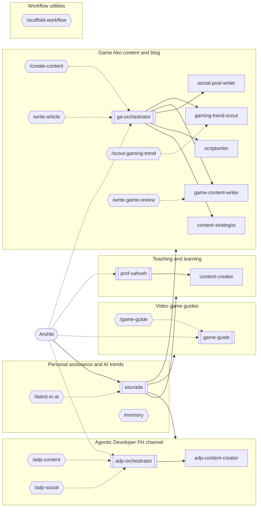

# Personal workflow

Arohbi's unified agent workspace. One front door, Asurada, routes work to domain agents and skills across these fields:

| Domain | Lead | Use it for |
| --- | --- | --- |
| Personal and AI trends | Asurada | Research, analysis, automation, decisions; `/latest-in-ai` weekly digest |
| Teaching and learning | Prof. Vahveh | Lesson planning, educational materials, assignments, student assessment |
| Agentic Developer PH | ADP Orchestrator | Channel content drafts and explicitly requested social publishing |
| Video game guides | Game Guide (SecondSeat principle) | Quick, spoiler-safe help while playing: builds, bosses, routes, missables |
| Game Ako content and blog | GA-Orchestrator | `/create-content`, `/write-article`, `/scout-gaming-trend`, YouTube packaging |
| Workflow utilities | Any agent | `/scaffold-workflow` to add agents, skills, commands, and domains |

`registry.md` has the full, always-current map of agents, commands, skills, and artifact folders.

## Delegation map

Double-bordered boxes are agents you can open directly; single boxes are subagents; hexagons are commands. Solid arrows are delegation; dotted arrows show direct access or which agent a command runs as.

<!-- BEGIN GENERATED: delegation-map (npm run sync) -->

<!-- END GENERATED: delegation-map -->

How the pieces fit together (sources, generator, skills, and artifacts): `docs/architecture/workflow-relationships.md`.

The managed-platform contract and clean-checkout instructions are in `docs/architecture/portability.md`.

## Using it

- **OpenCode / Claude Code:** sessions in this repository open as Asurada. Ask for anything; Asurada answers directly or routes to a domain lead. You can also switch directly to Prof. Vahveh, ADP Orchestrator, GA Orchestrator, or Game Guide.
- **Codex:** ask for the `asurada`, `prof-vahveh`, `adp-orchestrator`, `ga-orchestrator`, or `game-guide` agent. Commands are available as skills (for example, "run create-content").

Commands:

- `/latest-in-ai [slug]` saves an AI trend digest to `docs/ai-trends/` (Asurada only).
- `/memory <remember|recall|forget|compact|export|import> [detail]` manages your private, portable memory in the gitignored `memory/` folder.
- `/adp-content <topic> <format> <audience>` coordinates an Agentic Developer PH draft.
- `/adp-social <content> <platform> <audience>` adapts ADP copy and publishes only when explicitly authorized.
- `/game-guide <game> <question>` gives quick, spoiler-safe help for a game you are playing.
- `/create-content <topic and content type>` plans or drafts Game Ako scripts, YouTube packaging, posts, and packages.
- `/write-article <topic and article type>` drafts a Game Ako blog article with SEO metadata.
- `/scout-gaming-trend <topic> [time period]` returns a sourced gaming trend brief.
- `/scaffold-workflow [all=true|agent=true|skill=true|command=true] <brief>` extends the workspace.

## Extending it

1. Describe the new work (see `templates/brief.md`) and run `/scaffold-workflow`, or edit the canonical sources directly: `workflow.yaml`, `agents/`, `commands/`, `.agents/skills/`, `context/`.
2. Run `npm run sync` to regenerate platform files, `registry.md`, and the map above.
3. Run `npm run check` until it passes.
4. Optionally add routing cases to `tests/routing.yaml` and run `npm run eval` (uses OpenCode and model calls).
5. Restart your OpenCode, Claude Code, or Codex session to load the changes.

See `AGENTS.md` for conventions and platform details.

## Open items

- Fill in the placeholders in `context/game-ako-youtube.md` (standard description block) and `context/game-ako-blog.md` (Next.js blog metadata schema, affiliate or sponsorship policy).
- Analytics-fed channel review is deferred.
