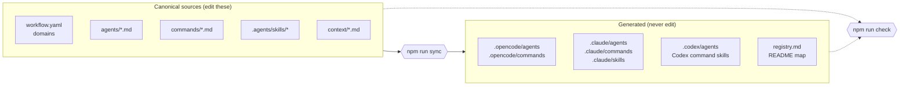
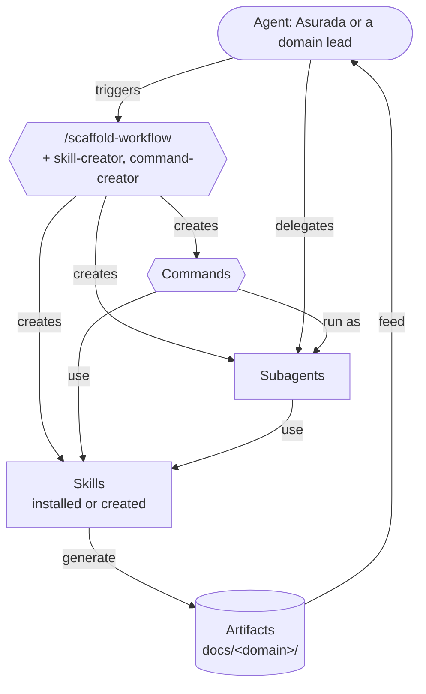

# Workflow relationships

How the workspace is built and how work flows through it. This replaces the earlier `agentic-workflow-relationships.jpg`. For the live map of which agent delegates to which, see the delegation map in `README.md` and `registry.md`, both generated by `npm run sync`.

## Build flow

Canonical sources are written once; the generator produces every managed platform file.

## Work flow

An agent uses the creation workflow to extend the workspace; agents and commands use skills to do the work; skills produce artifacts that feed later work.

## Rules the diagrams encode

- Every subagent has a caller (listed in some agent's `delegates`); every skill is used by an agent or command.
- Domain leads coordinate multi-piece work; single deliverables can go straight to a subagent.
- Time-sensitive Game Ako work gets a `gaming-trend-scout` brief before writing.
- Artifacts are saved only on request, under the domain folders in `workflow.yaml`, following `context/artifacts.md`.
