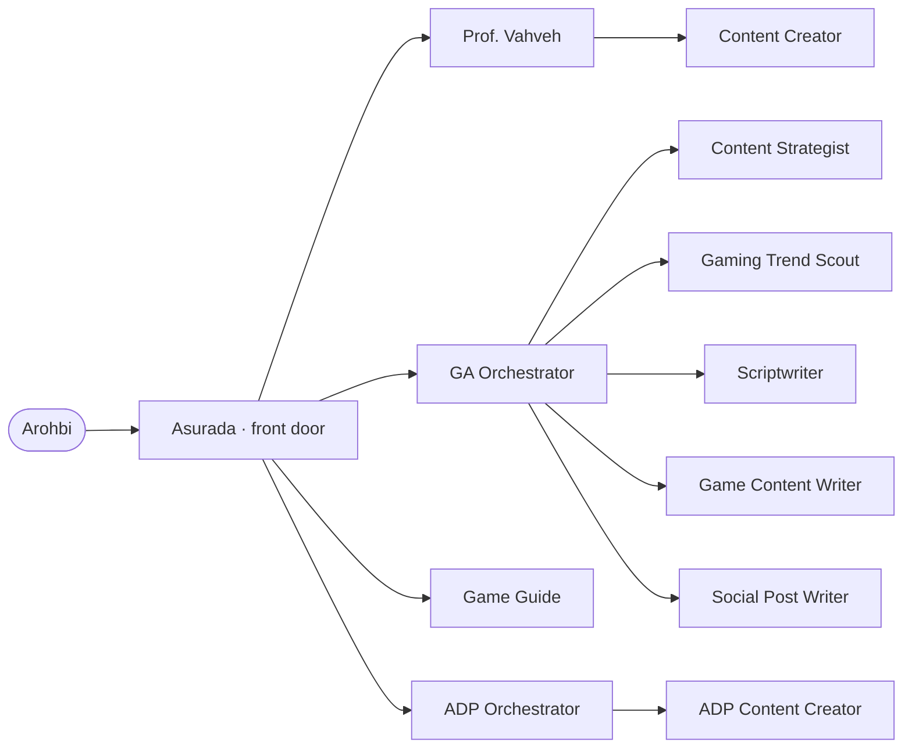

# Current Workflow Map

**Prepared:** 2026-09-30  
**Updated:** 2026-10-01, after the Phase D efficiency and maintenance audit (all four improvement phases are now implemented)  
**Purpose:** Describe the workflow currently configured in this repository so another model can assess it and propose improvements. This is an inventory, not a redesign.

## 1. Executive summary

This repository is a **cross-model agent-workflow configuration**, not an application. Its canonical configuration defines six work domains, one general front door, specialist coordinators and workers, reusable skills, slash-command workflows, shared context, and domain-specific artifact locations. A generator distributes the canonical setup to OpenCode, Claude Code, and Codex. A local-only, gitignored memory store supports continuity across those tools and other harnesses without being generated into prompts.

The interaction model is:

1. Arohbi starts with **Asurada** for general requests or asks for a domain specialist directly.
2. Asurada handles general research, analysis, automation, decision support, AI trends, and quick game help, or routes specialist work.
3. Domain leads coordinate requests that cross multiple deliverables; focused subagents and skills handle defined tasks.
4. Work is shown in chat by default. Requested saved outputs go into designated `docs/` folders.
5. Generated content is not published or shared without explicit approval. The publishing capability described for Agentic Developer PH is an exception gated by an explicit request, destination, and authorized connection.

The six declared domains cover personal assistance and AI trends, teaching and learning, Agentic Developer PH, personal video-game guidance, Game Ako content and blog work, and maintaining the workflow itself. The configuration does **not** currently define dedicated domains for every possible personal or professional life area; the broad `personal` domain is the only general-purpose area.

## 2. How this map was assembled

The primary sources are `workflow.yaml`, `agents/*.md`, `commands/*.md`, `.agents/skills/*/SKILL.md`, and `context/*.md`. `registry.md` and the delegation map in `README.md` are generated summaries. The artifact rules are in `context/artifacts.md`; Game Ako operating context is split across `context/game-ako.md` (core channel facts), `context/game-ako-youtube.md` (YouTube conventions), and `context/game-ako-blog.md` (blog conventions) so subagents include only task-relevant conventions.

When the sources differ in detail, the canonical files are the authority. This report records the current declared design and does not assume that every capability has been exercised or that every artifact folder is populated.

## 3. Domain map

| Domain | Lead | Current purpose and scope | Registered artifact locations |
| --- | --- | --- | --- |
| **Personal assistance and AI trends** (`personal`) | Asurada | Daily research, analysis, automation, decision support, private portable memory, and a weekly AI trend digest. | `docs/ai-trends/` (private memory is stored separately in ignored `memory/`) |
| **Teaching and learning** (`teaching`) | Prof. Vahveh | Structured teaching and learning work: lesson planning, educational materials, assignments, and student assessment/feedback. | `docs/teaching/` |
| **Agentic Developer PH channel** (`agentic-developer-ph`) | ADP Orchestrator | Channel planning and creation of researched scripts, articles, and social copy; platform adaptation and explicitly requested social publishing. | `docs/adp/` |
| **Video game guides** (`game-guide`) | Game Guide | Spoiler-safe, source-grounded help for Arohbi's own play: progression, builds, bosses, routes, missables, and co-op. Uses the “SecondSeat” principle. | `docs/games/` |
| **Game Ako content and blog** (`game-ako`) | GA Orchestrator | YouTube-first channel planning and production, Facebook promotion, blog writing, and gaming trend research. | `docs/game-ako/sources/`, `research/`, `plans/`, `scripts/`, `articles/`, `posts/` |
| **Workflow utilities** (`utility`) | Any agent | Add or maintain domains, agents, subagents, skills, and commands in this repository. | None |

### Scope not represented as a dedicated domain

The user context in `agents/asurada.md` mentions software engineering alongside content creation, and the `personal` domain is described broadly. However, there is no dedicated software-engineering domain, agent, command, artifact taxonomy, or specialized workflow in the current registry. Likewise, the repository does not declare other dedicated life-management areas such as health, finances, household administration, or relationships. This means “not configured here,” not necessarily “not part of Arohbi's life or intended system.”

## 4. Agents and responsibilities

There are **12 canonical agents**: five directly addressable agents (front door, coordinators, or standalone specialists) and seven focused subagents/workers. `mode: all` agents can act as direct specialists as well as delegated workers.

| Agent | Mode / domain | Main responsibility | Delegates to |
| --- | --- | --- | --- |
| **Asurada** (`asurada`) | Primary / personal | Main front door; handles general work and AI trends, gives quick game guidance, and routes specialist requests. | Any agent; domain routes include Prof. Vahveh, ADP Orchestrator, GA Orchestrator, and Game Guide. |
| **Prof. Vahveh** (`prof-vahveh`) | Primary / teaching | Coordinates lesson planning, educational content creation, and student assessment. | Content Creator. |
| **ADP Orchestrator** (`adp-orchestrator`) | Primary / Agentic Developer PH | Leads ADP content and social workflows; reviews drafts and manages explicit, authorized publishing requests. | ADP Content Creator. |
| **GA Orchestrator** (`ga-orchestrator`) | All / Game Ako | Coordinates Game Ako planning, research, scripts, packaging, articles, and social copy. | Content Strategist; Scriptwriter; Social Post Writer; Game Content Writer; Gaming Trend Scout. |
| **Game Guide** (`game-guide`) | All / game-guide | Direct, interactive game companion; confirms version-sensitive context and spoiler level. | None. |
| **Content Creator** (`content-creator`) | Subagent / teaching | Produces educational materials, assignments, lecture talking points, and scripts aligned to objectives. English-only. | None. |
| **ADP Content Creator** (`adp-content-creator`) | Subagent / Agentic Developer PH | Researches and drafts ADP scripts, social copy, and blog articles using shared writing methods and ADP context; never publishes. | None. |
| **Content Strategist** (`content-strategist`) | Subagent / Game Ako | Makes small, sustainable, YouTube-first plans and repurposing sequences; does not write scripts or packaging. | None. |
| **Game Content Writer** (`game-content-writer`) | Subagent / Game Ako | Writes sourced, SEO-aware Game Ako blog articles; does not invent hands-on review experience or publish. | None. |
| **Gaming Trend Scout** (`gaming-trend-scout`) | Subagent / Game Ako | Produces current, sourced research on premium console/PC AA/AAA games and gacha (including mobile gacha); excludes other mobile gaming, esports, and competitive scenes. | None. |
| **Scriptwriter** (`scriptwriter`) | Subagent / Game Ako | Writes long- and short-form spoken scripts and YouTube packaging. Taglish scripts by default; English titles and Taglish descriptions. | None. |
| **Social Post Writer** (`social-post-writer`) | Subagent / Game Ako | Writes platform-specific Game Ako social posts, especially Facebook promotion that points to YouTube. Does not publish. | None. |

### Delegation shape



The generated map also shows direct user access to Prof. Vahveh, ADP Orchestrator, GA Orchestrator, and Game Guide. Asurada routes ADP work through its dedicated lead; Game Ako single deliverables may go directly to a specialist worker, while packages go through GA Orchestrator.

## 5. Commands and repeatable workflows

There are **nine canonical commands**. Each has a specified execution agent and one or more skills.

| Command | Runs as | Workflow summary | Main output/location |
| --- | --- | --- | --- |
| `/latest-in-ai [slug]` | Asurada | Researches the previous seven days by default across models/research, tools/products, and market/industry; expands to 30 days if fewer than five meaningful verified items are found. | Cited digest saved to `docs/ai-trends/`. |
| `/memory <remember|recall|forget|compact|export|import> [detail]` | Current agent | Manages the private memory store with deliberate writes, compacting, and user-controlled plain-text import/export. | Local-only files under gitignored `memory/`; never in `docs/` or generated prompts. |
| `/game-guide <game> <question or goal>` | Game Guide | Establishes game/version context, defaults to spoiler-free, confirms before story spoilers, researches guides and patch details, then gives concise actionable help. | Answer in chat; requested guide/checklist in `docs/games/`. |
| `/adp-content <topic> <format> <audience>` | ADP Orchestrator | Briefs and delegates original ADP research/writing, then reviews source support and audience/format fit. | Draft in chat; requested file under `docs/adp/`. |
| `/adp-social <content> <platform> <audience>` | ADP Orchestrator | Uses shared social-copy guidance; publishes only if explicitly requested and the destination/authorized connection are clear. | Platform-ready copy; requested record under `docs/adp/`; publication must be confirmed. |
| `/create-content <topic and content type>` | GA Orchestrator | Clarifies output; researches time-sensitive claims first; plans if needed; creates an anchor piece, then packaging and companion Shorts/Reels/posts; reviews consistency and sources. | Plan, scripts, YouTube packaging, and posts in chat; requested saved pieces use corresponding Game Ako folders. |
| `/scout-gaming-trend <topic> [time period]` | Gaming Trend Scout (isolated task) | Returns a date-scoped, source-linked brief within the Game Ako coverage boundary, distinguishing evidence, claims, analysis, and gaps. | Brief in chat; requested file in `docs/game-ako/research/`. |
| `/write-article <topic and article type>` | GA Orchestrator | Researches current claims first when needed, delegates to Game Content Writer, checks review-experience limitations, and returns article plus SEO metadata and source notes. | Article in chat; requested file in `docs/game-ako/articles/`. |
| `/scaffold-workflow [selectors] <brief>` | Current agent | Creates or updates selected workflow entities from canonical sources, checks dependencies, then runs generator and validation. | Workflow configuration; generated files refreshed by `npm run sync`. |

Commands are generated as native commands for managed platforms. Codex receives command entry points as skills (either existing skills or generated wrappers). `/create-content` and `/scaffold-workflow` use wrapper skills; other command entries map to existing skills.

## 6. Skills and capabilities

Skills encode task-specific methods and constraints used by agents and commands. The repository currently has **22 skill files**: 15 first-party task/capability skills, two generated command-wrapper skills for Codex, and five installed third-party skills listed by the registry. The principal workflow capabilities are:

| Capability group | Skills |
| --- | --- |
| Personal research, memory, and game guidance | `ai-trend-tracker`, `game-guide-expert`, `memory-management` |
| Teaching | `lesson-planning`, `content-creation`, `student-assessment` |
| Shared writing methods used by ADP and Game Ako | `content-writing`, `article-writing`, `long-form-scriptwriting`, `short-form-scriptwriting`, `social-post-writing` |
| Agentic Developer PH-specific publishing | `adp-social-media-posting` |
| Game Ako planning and research | `content-strategy`, `gaming-trend` |
| Game Ako-specific strategy, research, and packaging | `content-strategy`, `gaming-trend`, `youtube-packaging` |
| Workflow construction | `scaffold-workflow`; the installed `skill-creator` and `command-creator` support scaffolding |

Installed third-party skills recorded in `registry.md` are `command-creator`, `create-agentsmd`, `frontend-design`, `professional-proofreader`, and `skill-creator`. The registry currently connects `command-creator` and `skill-creator` to workflow scaffolding; the other three are listed as installed but have no mapped agent/command caller there. The command-wrapper skills generated for Codex are entry points rather than additional canonical workflows.

## 7. Artifact model and current inventory

### Save conventions

`context/artifacts.md` establishes that outputs are **on-screen by default** and only saved when explicitly requested, except workflows that explicitly make saving part of invocation (currently `/latest-in-ai`). Saved files:

- live under the repository root in the folder owned by the relevant domain;
- use a normalized lowercase slug, with a date/date range when time-bound;
- are not overwritten (numeric suffixes are added when needed);
- should be self-contained, with scope/assumptions, date range, content, and direct source links;
- must not include secrets or private data not requested for storage.

### Registered artifact taxonomy

| Domain | Folder(s) | Intended material |
| --- | --- | --- |
| Personal | `docs/ai-trends/` | AI trend digests |
| Teaching | `docs/teaching/` | Lesson plans, educational materials, assignments, assessments, feedback reports |
| Agentic Developer PH | `docs/adp/` | Channel scripts, social posts, blog articles |
| Game guide | `docs/games/` | Guides, walkthroughs, checklists |
| Game Ako | `docs/game-ako/sources/` | User-supplied notes and source material |
| Game Ako | `docs/game-ako/research/` | Gaming trend briefs and research |
| Game Ako | `docs/game-ako/plans/` | Content plans |
| Game Ako | `docs/game-ako/scripts/` | Long- and short-form scripts |
| Game Ako | `docs/game-ako/articles/` | Blog article drafts |
| Game Ako | `docs/game-ako/posts/` | Social post drafts |

The current file inventory includes examples under `docs/adp/` and Game Ako `sources/`, `research/`, `scripts/`, and `articles/`, as well as workflow architecture and archived briefs. No artifact files were found in the inventory for AI trends, teaching, game guides, Game Ako plans, or Game Ako posts. This is only a snapshot of files, not evidence that those folders or workflows are unused.

## 8. Shared operating rules and context

- **Accuracy and evidence:** Verify current or uncertain facts with reliable sources; cite them; distinguish established findings from estimates, predictions, vendor claims, opinion, and open questions.
- **Human approval:** Agents draft and advise. Game Ako content is not published, scheduled, or shared by agents. ADP social publication is possible only when explicitly requested, through an authorized connection, and with the platform response confirming success.
- **Delegation:** Pass the specialist the full brief, constraints, and user-supplied sources. Coordinators review delegated work before returning it.
- **Clarification and escalation:** Agents generally ask one focused question when ambiguity materially changes the result; they escalate when authorization, tools, or capability are missing.
- **Game Ako channel context:** YouTube is the home base and monetization target; Facebook is promotional and should lead to YouTube; the blog is a written editorial home. The audience is Filipino gamers in the Philippines and abroad. Long-form pieces anchor repurposed short-form content. The channel context also sets language defaults, tone, topical coverage, and a few dated audience figures that must not be treated as live analytics.
- **Teaching context:** Content is aligned to supplied learning objectives, standards, and learner needs. Student work and identifying details are treated carefully. The teaching-material writer is English-only.
- **Platform maintenance:** Canonical sources are managed for OpenCode, Claude Code, and Codex. Gemini CLI and GitHub Copilot are no longer targets; their prior configurations are retained in the user's backup archive and are absent from the working tree.

## 9. Workflow architecture and maintenance

The repository separates canonical sources from platform-generated output:

```text
workflow.yaml + agents/ + commands/ + .agents/skills/ + context/
                              │
                         npm run sync
                              │
            registry.md + OpenCode + Claude + Codex files
                              │
                         npm run check
```

The intended design relationships are documented in `docs/architecture/workflow-relationships.md`: coordinators delegate to workers; commands invoke agents and skills; skills produce saved artifacts; artifacts can feed later work. `/scaffold-workflow` is the configured process for extending the system. Generated files should not be edited directly; run `npm run sync` and `npm run check` after canonical changes.

## 10. Explicit placeholders and known design boundaries

These are recorded in the current sources and are useful context for a later review:

1. **General personal domain is broad but shallow.** It covers general research/analysis/automation/decision support, private memory, and AI trends, but only AI trends has a saved artifact taxonomy.
2. **Software engineering is mentioned as user context, not a workflow domain.** No engineering-specific agent, skill, command, or artifact structure is mapped.
3. **Game Ako channel setup has unresolved placeholders**: the standard YouTube description links/disclaimer in `context/game-ako-youtube.md`, and the Next.js blog's metadata schema and affiliate/sponsorship policy in `context/game-ako-blog.md`.
4. **Analytics-fed channel review is explicitly deferred** in `README.md`; current plans should not infer performance from dated audience figures.
5. **Workflow evaluation exists but is optional.** `README.md` mentions routing cases in `tests/routing.yaml` and `npm run eval`; the core registry describes entities but does not itself show quality, outcome, or usage measures. Phase D added teaching-domain cases (the suite now covers the front door, memory, teaching, ADP, game guides, Game Ako, and scaffolding) and taught the eval to count a direct `SKILL.md` read as a skill routing action. Live runs depend on model quota: direct CLI calls can hit the OpenCode free-tier 403, as recorded for two ADP cases.
6. **Some installed skills are not connected to a domain workflow.** Phase D reviewed `create-agentsmd`, `frontend-design`, and `professional-proofreader` with Arohbi and kept all three as manually invoked: they are general-purpose (other repositories, engineering design work, manual proofreading) and no current domain owns them. `professional-proofreader`'s file mode uses an `UPDATED_` filename prefix that conflicts with `context/artifacts.md`, so connecting it to a managed workflow would first need that conflict resolved.
7. **ADP channel facts remain deliberately sparse.** `context/adp.md` records known language and workflow defaults while leaving demographics, platform roles, official destinations, and brand-specific SEO conventions open for Arohbi to supply.
8. **Current mapped domains are selective rather than a full life taxonomy.** Other personal/professional areas should be treated as unknown until Arohbi specifies whether they belong in this system.

## 11. Analysis questions for a follow-on model

Use the map above as evidence, not as a requirement to add more agents. Potential review questions:

- Which recurring areas of Arohbi's life and work should the workflow actually cover, and which should remain outside it?
- Are domain boundaries, leads, and direct-access paths intuitive, especially for general personal work versus teaching, ADP, software engineering, and Game Ako?
- Are any agents/skills/commands redundant, orphaned, too broad, or missing an explicit owner, input, output, or success condition?
- Do current workflows cover end-to-end outcomes (brief → research/planning → creation → review → approval → publication/archive) at the right level without unnecessary handoffs?
- Are artifact folders and naming rules sufficient for retrieval, reuse, privacy, and versioning across domains?
- Which decisions require human approval, and are those gates consistent across domains and platforms?
- What lightweight evaluation should show whether routing and outputs are useful (without inventing metrics or collecting unnecessary personal data)?
- Which known placeholders or deferred items should be resolved first, and what user input would be needed?
- Can proposed improvements remain simple enough to maintain across OpenCode, Claude Code, and Codex without adding unmanaged harness-specific files?

## 12. Source index

- Domain and platform registry: `workflow.yaml`
- Generated registry and delegation map: `registry.md`, `README.md`
- Front door and agent definitions: `agents/asurada.md` and the other files under `agents/`
- Command workflows: `commands/`
- Skill definitions and installed skills: `.agents/skills/`
- Shared artifact rules: `context/artifacts.md`
- Game Ako operating context: `context/game-ako.md`, `context/game-ako-youtube.md`, `context/game-ako-blog.md`
- Build/delegation architecture: `docs/architecture/workflow-relationships.md`
- Repository maintenance instructions: `AGENTS.md`
