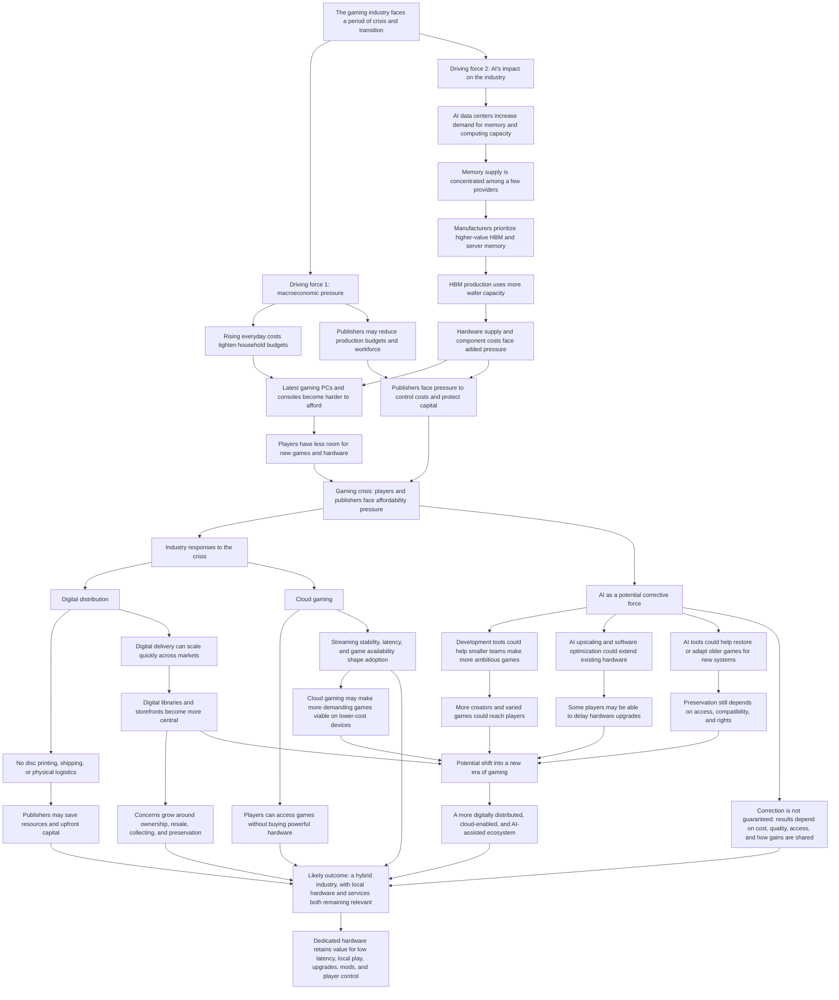

# The Future of Gaming: Crisis and Transition

Baseline idea map refined in this conversation. It frames macroeconomic pressure and AI's industry impact as drivers of crisis, with digital distribution and cloud gaming as responses and AI as a possible corrective force. Causal claims are presented as possibilities where outcomes depend on adoption and conditions. No external sources were used to verify the claims in this working map.

