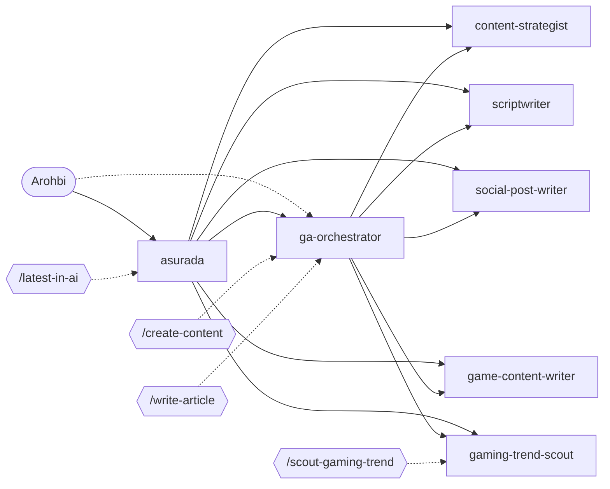

<!-- GENERATED by scripts/sync.mjs from workflow.yaml, agents/, commands/, and .agents/skills/. Do not edit; edit the source and run `npm run sync`. -->

# Workflow registry

Start with `asurada`: it handles general requests and routes specialist work to the domain lead or subagent listed here. Managed platforms: opencode, claude, codex. Frozen platforms (hand-maintained, not generated): gemini, copilot.

## Domains

| Domain | Lead | Purpose | Artifacts |
| --- | --- | --- | --- |
| Personal assistance and AI trends (`personal`) | `asurada` | Daily research, analysis, automation, decision support, and the weekly AI trend digest. | `docs/ai-trends/` |
| Video game guides (`game-guide`) | `asurada` | Walkthroughs, builds, boss strategies, routes, and co-op advice for Arohbi's own play. | `docs/games/` |
| Game Ako content and blog (`game-ako`) | `ga-orchestrator` | Game Ako channel planning, scripts, social posts, blog articles, and gaming trend research. | `docs/game-ako/sources/` `docs/game-ako/research/` `docs/game-ako/plans/` `docs/game-ako/scripts/` `docs/game-ako/articles/` `docs/game-ako/posts/` |
| Workflow utilities (`utility`) | any agent | Scaffold and maintain agents, subagents, skills, and commands in this repository. | — |

## Delegation map

## Personal assistance and AI trends (`personal`)

Daily research, analysis, automation, decision support, and the weekly AI trend digest.

**Agents**

| Agent | Mode | Called by | Delegates to | Skills | Description |
| --- | --- | --- | --- | --- | --- |
| `asurada` | primary | — | any agent | `ai-trend-tracker`, `game-guide-expert` | Asurada is Arohbi's primary assistant and front door for research, analysis, automation, decision support, game guides, and AI trends; routes specialist work to domain agents such as GA-Orchestrator. |

**Commands**

| Command | Runs as | Isolated | Skills | Codex entry | Description |
| --- | --- | --- | --- | --- | --- |
| `/latest-in-ai [slug]` | `asurada` | no | `ai-trend-tracker` | skill `ai-trend-tracker` | Research recent AI developments and save a cited digest |

**Skills**

| Skill | Used by | Description |
| --- | --- | --- |
| `ai-trend-tracker` | `asurada`, `/latest-in-ai` | Research and track recent AI developments across models and research, tools and products, and market and industry. Use when Arohbi asks for the latest AI news, a trend roundup, or a digest of AI developments. |

## Video game guides (`game-guide`)

Walkthroughs, builds, boss strategies, routes, and co-op advice for Arohbi's own play.

**Skills**

| Skill | Used by | Description |
| --- | --- | --- |
| `game-guide-expert` | `asurada` | Provide accurate, practical game guidance, strategies, walkthroughs, builds, boss help, progression routes, and co-op advice for retro and modern games. Use whenever Arohbi asks how to progress, improve, choose a build, beat an encounter, find an item, or plan a route in a game, especially JRPGs, action, adventure, survival, shooter, and open-world games. Check the exact game, edition, platform, and patch when they affect the answer; save requested guide artifacts under docs/games/. |

## Game Ako content and blog (`game-ako`)

Game Ako channel planning, scripts, social posts, blog articles, and gaming trend research.

**Agents**

| Agent | Mode | Called by | Delegates to | Skills | Description |
| --- | --- | --- | --- | --- | --- |
| `content-strategist` | subagent | `asurada`, `ga-orchestrator` | — | `content-strategy` | Turns Game Ako goals and topics into achievable YouTube-first content plans, formats, schedules, and repurposing paths. |
| `ga-orchestrator` | all | `asurada` | `content-strategist`, `scriptwriter`, `social-post-writer`, `game-content-writer`, `gaming-trend-scout` | — | GA Orchestrator leads the Game Ako domain, coordinating content plans, scripts, social posts, blog articles, and gaming trend research for Arohbi's YouTube and Facebook channel and blog. |
| `game-content-writer` | subagent | `asurada`, `ga-orchestrator` | — | `article-writing` | Write well-researched Game Ako blog articles, reviews, news updates, features, and opinion pieces with accurate sourcing and reader-friendly SEO. Use for gaming editorial writing; never invents hands-on review experience. |
| `gaming-trend-scout` | subagent | `asurada`, `ga-orchestrator` | — | `gaming-trend` | Research current console and PC gaming developments, focusing on premium AA and AAA games, and cover gacha games including mobile gacha. Exclude other mobile gaming, esports, and competitive scenes. |
| `scriptwriter` | subagent | `asurada`, `ga-orchestrator` | — | `long-form-scriptwriting`, `short-form-scriptwriting` | Writes conversational long-form and short-form scripts for Game Ako videos, podcasts, livestreams, Shorts, and Reels. |
| `social-post-writer` | subagent | `asurada`, `ga-orchestrator` | — | `social-post-writing` | Writes platform-specific social copy for Game Ako, with Facebook promotion that points viewers toward YouTube. |

**Commands**

| Command | Runs as | Isolated | Skills | Codex entry | Description |
| --- | --- | --- | --- | --- | --- |
| `/create-content <topic and content type>` | `ga-orchestrator` | no | `content-strategy`, `long-form-scriptwriting`, `short-form-scriptwriting`, `social-post-writing` | wrapper skill `create-content` | Plan and create a Game Ako content piece or package (plan, long-form script, short-form script, social post) with companion pieces |
| `/scout-gaming-trend <topic or trend> [time period]` | `gaming-trend-scout` | yes | `gaming-trend` | skill `gaming-trend` | Research current console and PC premium AA and AAA games, plus gacha games including mobile gacha, and return a sourced Game Ako brief |
| `/write-article <topic and article type>` | `ga-orchestrator` | no | `article-writing` | skill `article-writing` | Draft a researched Game Ako blog article, review, news update, feature, or opinion piece |

**Skills**

| Skill | Used by | Description |
| --- | --- | --- |
| `article-writing` | `game-content-writer`, `/write-article` | Write engaging, well-researched Game Ako blog articles, reviews, news updates, features, and opinion pieces. Use whenever Arohbi requests gaming editorial content or runs /write-article; provides source attribution, natural SEO, and honest separation of reporting and opinion. |
| `content-strategy` | `content-strategist`, `/create-content` | Build a practical, sustainable content plan for Game Ako from a topic, goal, audience, or requested cadence. Use whenever Arohbi asks what to make, how to sequence content, or how to plan YouTube and Facebook content. |
| `gaming-trend` | `gaming-trend-scout`, `/scout-gaming-trend` | Research current console and PC gaming news, trends, announcements, and market developments, focusing on premium AA and AAA games. Also cover gacha games as an explicit exception, including mobile gacha; exclude other mobile gaming, esports, and competitive scenes. Use whenever Arohbi asks what is happening in these areas or wants a sourced brief for Game Ako content planning. |
| `long-form-scriptwriting` | `scriptwriter`, `/create-content` | Outline or draft long-form spoken content for Game Ako, including YouTube commentary videos, podcasts, and livestreams. Use whenever Arohbi asks for a full script, outline, episode structure, talking points, or long-form rewrite. |
| `short-form-scriptwriting` | `scriptwriter`, `/create-content` | Write or revise concise, self-contained scripts for YouTube Shorts, Facebook Reels, and other short-form gaming content. Use whenever Arohbi requests a short video script, reel, short, hook, or a short-form adaptation. |
| `social-post-writing` | `social-post-writer`, `/create-content` | Draft or refine social media posts and captions for Game Ako, including Facebook announcements, engagement posts, and captions for YouTube or short-form video. Use whenever Arohbi asks for platform-specific post copy. |

## Workflow utilities (`utility`)

Scaffold and maintain agents, subagents, skills, and commands in this repository.

**Commands**

| Command | Runs as | Isolated | Skills | Codex entry | Description |
| --- | --- | --- | --- | --- | --- |
| `/scaffold-workflow [all=true\|agent=true\|skill=true\|command=true] <workflow brief>` | current agent | no | `skill-creator`, `command-creator` | wrapper skill `scaffold-workflow` | Scaffold or update agents, subagents, skills, commands, and domains from a workflow brief |

## Installed third-party skills

Installed from `skills-lock.json`; update them with the skills installer, not by hand.

| Skill | Source | Used by |
| --- | --- | --- |
| `command-creator` | softaworks/agent-toolkit | `/scaffold-workflow` |
| `create-agentsmd` | github/awesome-copilot | — |
| `frontend-design` | anthropics/skills | — |
| `skill-creator` | anthropics/skills | `/scaffold-workflow` |

## Generated files

`npm run sync` writes these from the canonical sources; `npm run check` fails when they drift:

- `.opencode/agents/`
- `.opencode/commands/`
- `.claude/agents/`
- `.claude/commands/`
- `.claude/skills/`
- `.codex/agents/`
- `.agents/skills/<command>/SKILL.md` for commands with `codex: wrapper`
- `registry.md`
