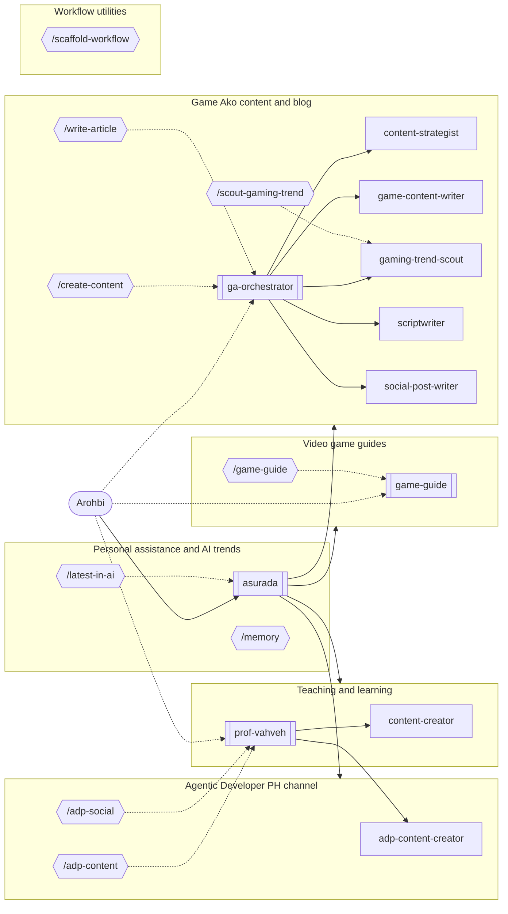

<!-- GENERATED by scripts/sync.mjs from workflow.yaml, agents/, commands/, and .agents/skills/. Do not edit; edit the source and run `npm run sync`. -->

# Workflow registry

Start with `asurada`: it handles general requests and routes specialist work to the domain lead or subagent listed here. Managed platforms: opencode, claude, codex. Frozen platforms (hand-maintained, not generated): none.

## Domains

| Domain | Lead | Purpose | Artifacts |
| --- | --- | --- | --- |
| Personal assistance and AI trends (`personal`) | `asurada` | Daily research, analysis, automation, decision support, Arohbi's private portable memory, and the weekly AI trend digest. | `docs/ai-trends/` |
| Teaching and learning (`teaching`) | `prof-vahveh` | To create a structured approach for teaching and learning activities. | `docs/teaching/` |
| Agentic Developer PH channel (`agentic-developer-ph`) | `prof-vahveh` | Agentic Developer PH channel planning, scripts, social posts, blog articles, and ai trend research. | `docs/adp/` |
| Video game guides (`game-guide`) | `game-guide` | Quick, spoiler-safe walkthroughs, builds, boss strategies, routes, and co-op advice for Arohbi's own play (SecondSeat principle). | `docs/games/` |
| Game Ako content and blog (`game-ako`) | `ga-orchestrator` | Game Ako channel planning, scripts, social posts, blog articles, and gaming trend research. | `docs/game-ako/sources/` `docs/game-ako/research/` `docs/game-ako/plans/` `docs/game-ako/scripts/` `docs/game-ako/articles/` `docs/game-ako/posts/` |
| Workflow utilities (`utility`) | any agent | Scaffold and maintain agents, subagents, skills, and commands in this repository. | — |

## Delegation map

## Personal assistance and AI trends (`personal`)

Daily research, analysis, automation, decision support, Arohbi's private portable memory, and the weekly AI trend digest.

**Agents**

| Agent | Mode | Called by | Delegates to | Skills | Description |
| --- | --- | --- | --- | --- | --- |
| `asurada` | primary | — | any agent | `ai-trend-tracker`, `game-guide-expert`, `memory-management` | Asurada is Arohbi's primary assistant and front door for research, analysis, automation, decision support, game guides, and AI trends; routes specialist work to domain agents such as Prof. Vahveh and GA-Orchestrator. |

**Commands**

| Command | Runs as | Isolated | Skills | Codex entry | Description |
| --- | --- | --- | --- | --- | --- |
| `/latest-in-ai [slug]` | `asurada` | no | `ai-trend-tracker` | skill `ai-trend-tracker` | Research recent AI developments and save a cited digest |
| `/memory <remember\|recall\|forget\|compact\|export\|import> [detail]` | current agent | no | `memory-management` | skill `memory-management` | Manage Arohbi's private, portable memory — remember, recall, forget, compact, export, and import |

**Skills**

| Skill | Used by | Description |
| --- | --- | --- |
| `ai-trend-tracker` | `asurada`, `/latest-in-ai` | Research and track recent AI developments across models and research, tools and products, and market and industry. Use when Arohbi asks for the latest AI news, a trend roundup, or a digest of AI developments. |
| `memory-management` | `asurada`, `/memory` | Manage Arohbi's private, portable memory — remember, recall, forget, compact session notes, and export or import plain bundles when switching models or harnesses. Use when Arohbi asks to remember, recall, or forget something, asks what the workflow knows about him, or runs /memory. |

## Teaching and learning (`teaching`)

To create a structured approach for teaching and learning activities.

**Agents**

| Agent | Mode | Called by | Delegates to | Skills | Description |
| --- | --- | --- | --- | --- | --- |
| `content-creator` | subagent | `asurada`, `prof-vahveh` | — | `content-creation` | Create accurate, engaging teaching materials, assignments, lecture talking points, and scripts aligned with supplied lesson plans and learning objectives. |
| `prof-vahveh` | primary | `asurada` | `content-creator`, `adp-content-creator` | `lesson-planning`, `content-creation`, `student-assessment`, `adp-content-writing`, `adp-social-media-posting` | Orchestrate teaching and Agentic Developer PH workflows, planning lessons, coordinating content creation and social publishing, and assessing student work. |

**Skills**

| Skill | Used by | Description |
| --- | --- | --- |
| `content-creation` | `content-creator`, `prof-vahveh` | Create educational materials, assignments, lecture talking points, and scripts from lesson plans and learning objectives. Use when a user asks to draft classroom-ready teaching content; this skill creates materials rather than planning lesson structure or evaluating student work. |
| `lesson-planning` | `prof-vahveh` | Design structured lesson plans from learning objectives, curriculum standards, and student needs. Use when a user asks to plan, organize, sequence, or structure a lesson; focus on the lesson design rather than drafting its full teaching materials. |
| `student-assessment` | `prof-vahveh` | Evaluate student work against supplied assessment criteria and learning objectives, then provide specific, constructive feedback. Use when a user asks to review, assess, score, or give feedback on student work; do not use for creating lesson plans or authoring assessment materials. |

## Agentic Developer PH channel (`agentic-developer-ph`)

Agentic Developer PH channel planning, scripts, social posts, blog articles, and ai trend research.

**Agents**

| Agent | Mode | Called by | Delegates to | Skills | Description |
| --- | --- | --- | --- | --- | --- |
| `adp-content-creator` | subagent | `asurada`, `prof-vahveh` | — | `adp-content-writing`, `adp-social-media-posting` | Create researched, audience-aware scripts, social copy, and blog articles for Agentic Developer PH, following the requested format and content-writing or social-publishing workflow. |

**Commands**

| Command | Runs as | Isolated | Skills | Codex entry | Description |
| --- | --- | --- | --- | --- | --- |
| `/adp-content <topic> <format> <audience>` | `prof-vahveh` | no | `adp-content-writing` | skill `adp-content-writing` | Research and create Agentic Developer PH content in the requested format for its specified audience. |
| `/adp-social <content> <platform> <audience>` | `prof-vahveh` | no | `adp-social-media-posting` | skill `adp-social-media-posting` | Format Agentic Developer PH content for a specified social platform and publish it when requested. |

**Skills**

| Skill | Used by | Description |
| --- | --- | --- |
| `adp-content-writing` | `adp-content-creator`, `prof-vahveh`, `/adp-content` | Research and create scripts, social copy drafts, and blog articles for Agentic Developer PH from a topic, format, and audience. Use when asked to write original channel content; it does not publish or post content to social platforms. |
| `adp-social-media-posting` | `adp-content-creator`, `prof-vahveh`, `/adp-social` | Adapt supplied or approved Agentic Developer PH content for a specified social platform and publish it when the user requests a post. Use for platform formatting and posting tasks, not for writing scripts or blog articles. |

## Video game guides (`game-guide`)

Quick, spoiler-safe walkthroughs, builds, boss strategies, routes, and co-op advice for Arohbi's own play (SecondSeat principle).

**Agents**

| Agent | Mode | Called by | Delegates to | Skills | Description |
| --- | --- | --- | --- | --- | --- |
| `game-guide` | all | `asurada` | — | `game-guide-expert` | Game Guide gives quick, spoiler-safe help for Arohbi's own play sessions, including builds, bosses, routes, missables, co-op, and walkthroughs on request. Grounded in walkthroughs and guides, following the SecondSeat principle. |

**Commands**

| Command | Runs as | Isolated | Skills | Codex entry | Description |
| --- | --- | --- | --- | --- | --- |
| `/game-guide <game> <question or goal>` | `game-guide` | no | `game-guide-expert` | skill `game-guide-expert` | Get quick, spoiler-safe help for a game Arohbi is playing (progression, bosses, builds, items, routes, co-op), or a saved guide on request |

**Skills**

| Skill | Used by | Description |
| --- | --- | --- |
| `game-guide-expert` | `asurada`, `game-guide`, `/game-guide` | Provide accurate, practical game guidance, strategies, walkthroughs, builds, boss help, progression routes, and co-op advice for retro and modern games. Use whenever Arohbi asks how to progress, improve, choose a build, beat an encounter, find an item, or plan a route in a game, especially JRPGs, action, adventure, survival, shooter, and open-world games. Check the exact game, edition, platform, and patch when they affect the answer; save requested guide artifacts under docs/games/. |

## Game Ako content and blog (`game-ako`)

Game Ako channel planning, scripts, social posts, blog articles, and gaming trend research.

**Agents**

| Agent | Mode | Called by | Delegates to | Skills | Description |
| --- | --- | --- | --- | --- | --- |
| `content-strategist` | subagent | `asurada`, `ga-orchestrator` | — | `content-strategy` | Turns Game Ako goals and topics into achievable YouTube-first content plans, formats, schedules, and repurposing paths. |
| `ga-orchestrator` | all | `asurada` | `content-strategist`, `scriptwriter`, `social-post-writer`, `game-content-writer`, `gaming-trend-scout` | — | GA Orchestrator leads the Game Ako domain, coordinating content plans, scripts, YouTube packaging, social posts, blog articles, and gaming trend research for Arohbi's YouTube and Facebook channel and blog. |
| `game-content-writer` | subagent | `asurada`, `ga-orchestrator` | — | `article-writing` | Write well-researched Game Ako blog articles, reviews, news updates, features, and opinion pieces with accurate sourcing and reader-friendly SEO. Use for gaming editorial writing; never invents hands-on review experience. |
| `gaming-trend-scout` | subagent | `asurada`, `ga-orchestrator` | — | `gaming-trend` | Research current console and PC gaming developments, focusing on premium AA and AAA games, and cover gacha games including mobile gacha. Exclude other mobile gaming, esports, and competitive scenes. |
| `scriptwriter` | subagent | `asurada`, `ga-orchestrator` | — | `long-form-scriptwriting`, `short-form-scriptwriting`, `youtube-packaging` | Writes conversational long-form and short-form scripts for Game Ako videos, podcasts, livestreams, Shorts, and Reels, plus YouTube packaging (titles, descriptions, thumbnail text, chapters, tags). |
| `social-post-writer` | subagent | `asurada`, `ga-orchestrator` | — | `social-post-writing` | Writes platform-specific social copy for Game Ako, with Facebook promotion that points viewers toward YouTube. |

**Commands**

| Command | Runs as | Isolated | Skills | Codex entry | Description |
| --- | --- | --- | --- | --- | --- |
| `/create-content <topic and content type>` | `ga-orchestrator` | no | `gaming-trend`, `content-strategy`, `long-form-scriptwriting`, `short-form-scriptwriting`, `youtube-packaging`, `social-post-writing` | wrapper skill `create-content` | Plan and create a Game Ako content piece or package (plan, long-form script, short-form script, YouTube packaging, social post) with companion pieces |
| `/scout-gaming-trend <topic or trend> [time period]` | `gaming-trend-scout` | yes | `gaming-trend` | skill `gaming-trend` | Research current console and PC premium AA and AAA games, plus gacha games including mobile gacha, and return a sourced Game Ako brief |
| `/write-article <topic and article type>` | `ga-orchestrator` | no | `gaming-trend`, `article-writing` | skill `article-writing` | Draft a researched Game Ako blog article, review, news update, feature, or opinion piece |

**Skills**

| Skill | Used by | Description |
| --- | --- | --- |
| `article-writing` | `game-content-writer`, `/write-article` | Write engaging, well-researched Game Ako blog articles, reviews, news updates, features, and opinion pieces. Use whenever Arohbi requests gaming editorial content or runs /write-article; provides source attribution, natural SEO, and honest separation of reporting and opinion. |
| `content-strategy` | `content-strategist`, `/create-content` | Build a practical, sustainable content plan for Game Ako from a topic, goal, audience, or requested cadence. Use whenever Arohbi asks what to make, how to sequence content, or how to plan YouTube and Facebook content. |
| `gaming-trend` | `gaming-trend-scout`, `/create-content`, `/scout-gaming-trend`, `/write-article` | Research current console and PC gaming news, trends, announcements, and market developments, focusing on premium AA and AAA games. Also cover gacha games as an explicit exception, including mobile gacha; exclude other mobile gaming, esports, and competitive scenes. Use whenever Arohbi asks what is happening in these areas or wants a sourced brief for Game Ako content planning. |
| `long-form-scriptwriting` | `scriptwriter`, `/create-content` | Outline or draft long-form spoken content for Game Ako, including YouTube commentary videos, podcasts, and livestreams. Use whenever Arohbi asks for a full script, outline, episode structure, talking points, or long-form rewrite. |
| `short-form-scriptwriting` | `scriptwriter`, `/create-content` | Write or revise concise, self-contained scripts for YouTube Shorts, Facebook Reels, and other short-form gaming content. Use whenever Arohbi requests a short video script, reel, short, hook, or a short-form adaptation. |
| `social-post-writing` | `social-post-writer`, `/create-content` | Draft or refine social media posts and captions for Game Ako, including Facebook announcements, engagement posts, and captions for YouTube or short-form video. Use whenever Arohbi asks for platform-specific post copy. |
| `youtube-packaging` | `scriptwriter`, `/create-content` | Package a Game Ako YouTube upload with English title options, a Taglish description, thumbnail text, chapters, and tags. Use when Arohbi asks for a YouTube title, description, thumbnail text, chapters, timestamps, tags, or upload metadata for a video, podcast, livestream, or Short. |

## Workflow utilities (`utility`)

Scaffold and maintain agents, subagents, skills, and commands in this repository.

**Commands**

| Command | Runs as | Isolated | Skills | Codex entry | Description |
| --- | --- | --- | --- | --- | --- |
| `/scaffold-workflow [all=true\|agent=true\|skill=true\|command=true] <workflow brief>` | current agent | no | `skill-creator`, `command-creator` | wrapper skill `scaffold-workflow` | Scaffold or update agents, subagents, skills, commands, and domains from a workflow brief |

## Installed third-party skills

Installed from `skills-lock.json`; update them with the skills installer, not by hand.

| Skill | Source | Used by |
| --- | --- | --- |
| `command-creator` | softaworks/agent-toolkit | `/scaffold-workflow` |
| `create-agentsmd` | github/awesome-copilot | — |
| `frontend-design` | anthropics/skills | — |
| `professional-proofreader` | sickn33/agentic-awesome-skills | — |
| `skill-creator` | anthropics/skills | `/scaffold-workflow` |

## Generated files

`npm run sync` writes these from the canonical sources; `npm run check` fails when they drift:

- `.opencode/agents/`
- `.opencode/commands/`
- `.claude/agents/`
- `.claude/commands/`
- `.claude/skills/`
- `.codex/agents/`
- `.agents/skills/<command>/SKILL.md` for commands with `codex: wrapper`
- `registry.md`
